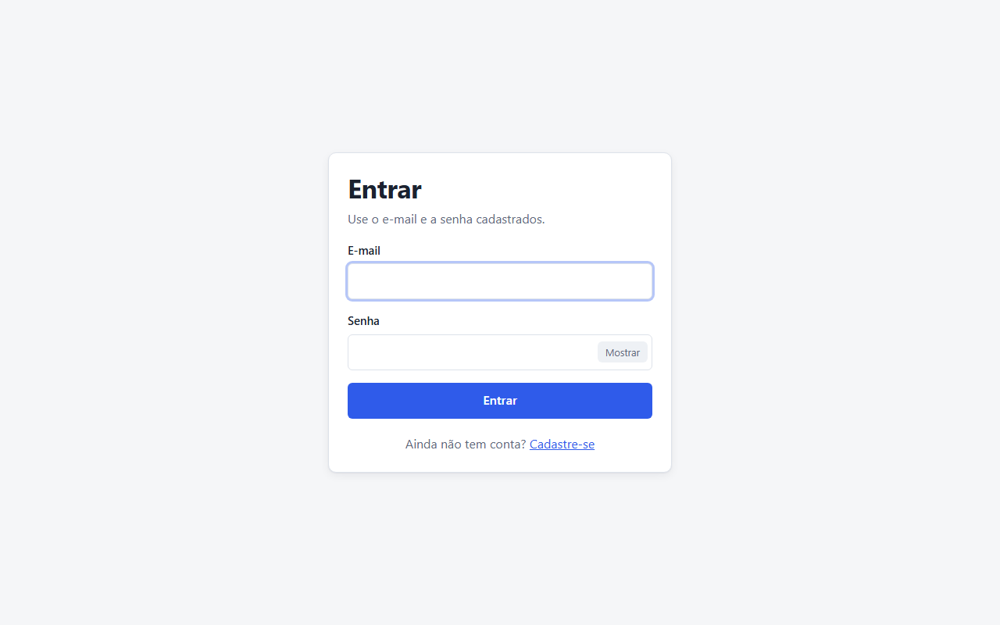
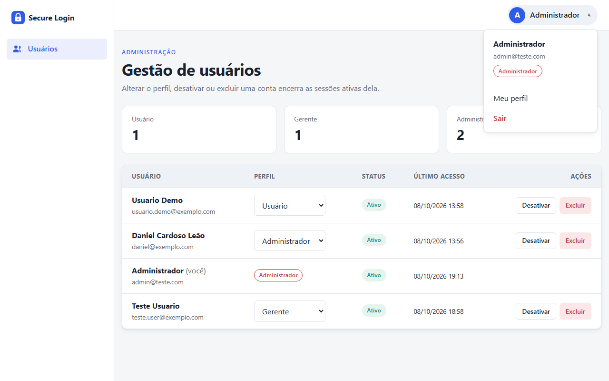
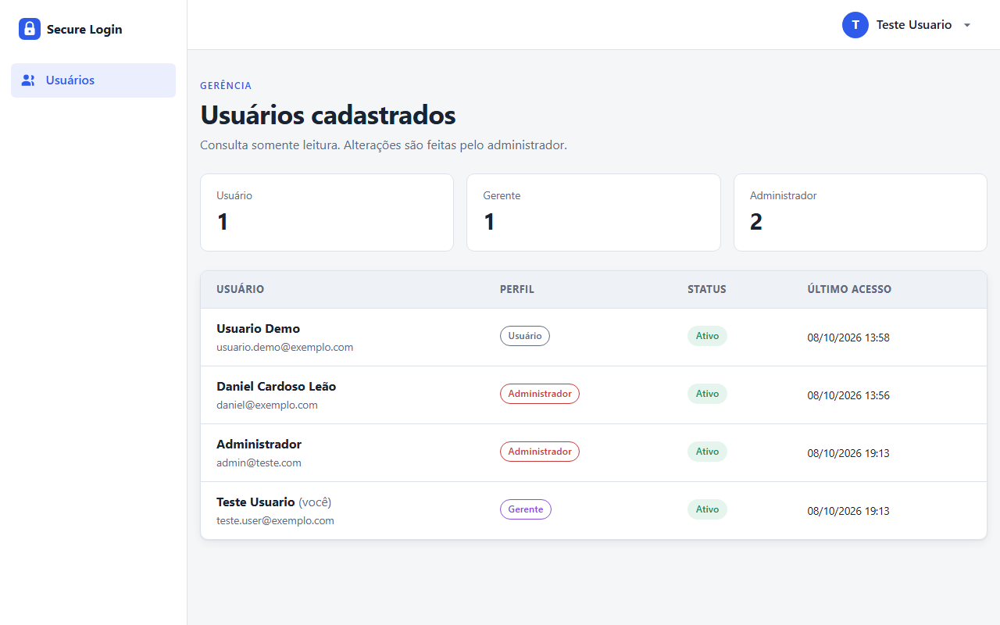
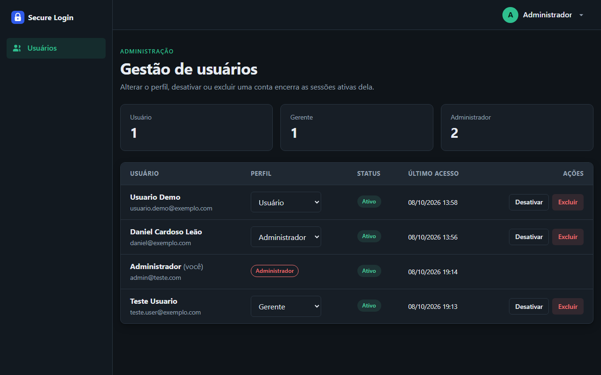

# Secure Login: Spring Boot + Thymeleaf + MongoDB Atlas

Sistema de login seguro com cadastro, autenticação, autorização por perfis (roles) e gestão de usuários. Foi construído como base genérica e modular, para ser reaproveitado em outros projetos (como o PFC) sem mudanças na lógica central.

> Atividade M1 da disciplina de Aplicativos Web, curso de Sistemas de Informação da Universidade de Mogi das Cruzes.

## Funcionalidades

- Cadastro com validação de dados e política de senha forte
- Login e logout com Spring Security (formulário próprio, CSRF ativo, logout via POST)
- Senhas criptografadas com **BCrypt** (custo 12)
- **3 perfis** com hierarquia: `ADMIN > MANAGER > USER`
- Controle de acesso por rota **e** por método (`@PreAuthorize`), mais elementos de tela condicionados ao perfil
- Tela única de gestão de usuários: o gerente consulta, o administrador altera perfis, ativa/desativa, desbloqueia e exclui contas
- Usuários **e sessões HTTP** armazenados no **MongoDB Atlas** (Spring Session)
- Bloqueio temporário da conta após 5 senhas incorretas (proteção contra força bruta)
- Limite de sessões simultâneas por usuário e encerramento automático das sessões quando o administrador altera o perfil, desativa ou exclui a conta, e das outras sessões quando o próprio usuário troca a senha
- Cabeçalhos de segurança (CSP, X-Frame-Options, Referrer-Policy) e cookie de sessão `HttpOnly` / `SameSite=Lax`
- Interface em Thymeleaf com **layout configurável e temas visuais** (claro e escuro incluídos)

## Telas

| Login | Gestão de usuários (ADMIN) |
|---|---|
|  |  |
| **Consulta de usuários (MANAGER)** | **Tema escuro (`APP_THEME=dark`)** |
|  |  |

## Tecnologias

| Tecnologia | Versão |
|---|---|
| Java (Temurin) | 21 |
| Spring Boot | 4.0.8 |
| Spring Security | 7.0 |
| Spring Data MongoDB | 5.0 |
| MongoDB Spring Session | 4.0 |
| Thymeleaf + Layout Dialect | 3.1 / 3.4 |
| Maven Wrapper | 3.9 |

## Perfis e permissões

| Rota | Visitante | USER | MANAGER | ADMIN |
|---|:-:|:-:|:-:|:-:|
| `/login`, `/register` | ✅ | - | - | - |
| `/profile` (Meu perfil) | ❌ | ✅ | ✅ | ✅ |
| `GET /users` (consulta de usuários) | ❌ | ❌ | ✅ | ✅ |
| `POST /users/**` (alterar perfil, ativar/desativar, desbloquear, excluir) | ❌ | ❌ | ❌ | ✅ |

Após o login, gerente e administrador entram direto na gestão de usuários; o usuário comum, que não tem acesso a ela, entra em **Meu perfil**. Quem já está logado e abre `/`, `/login` ou `/register` é levado à sua tela inicial.

Todo cadastro público recebe o perfil `USER`. O primeiro `ADMIN` é criado automaticamente na inicialização a partir das variáveis `ADMIN_EMAIL` e `ADMIN_PASSWORD`; a partir daí ele promove outros usuários pela gestão de usuários.

## Estrutura do projeto

```
src/main/java/br/com/danielcardoso/securelogin
├── config/        SecurityConfig, AuthorizationRules, MongoSessionConfig, AppProperties
├── security/      MongoUserDetailsService, tentativas de login, handlers, sessões, tela inicial por perfil
├── user/          domínio (User, Role), repository, service, dto e controllers de conta
├── admin/         gestão de usuários (UserManagementController)
├── theme/         resolução do tema visual ativo
├── web/           redirecionamento da raiz e dados comuns do layout
├── common/        validações customizadas e exceções
└── bootstrap/     criação do administrador inicial

src/main/resources
├── application.yml          configuração (lê segredos de variáveis de ambiente / .env)
├── templates/
│   ├── layouts/main.html    layout base (Layout Dialect)
│   ├── fragments/           sidebar, topbar (menu do usuário), alertas, badges, estatísticas
│   ├── auth/ users/ user/   telas de login/cadastro, gestão de usuários e Meu perfil
│   └── error/, error.html   páginas de erro (403, 404 e genérica)
└── static/
    ├── css/app.css          estrutura visual (usa só variáveis CSS)
    ├── js/app.js
    └── themes/{default,dark}/theme.css   tokens de design de cada tema
```

## Pré-requisitos

- **JDK 21** ([Eclipse Temurin](https://adoptium.net/)) com `JAVA_HOME` configurado
- Conta gratuita no [MongoDB Atlas](https://www.mongodb.com/cloud/atlas)
- Git

Não é preciso instalar o Maven: o projeto usa o Maven Wrapper (`mvnw` / `mvnw.cmd`).

## Configurando o MongoDB Atlas

1. Crie uma conta em [https://cloud.mongodb.com](https://cloud.mongodb.com) e um novo projeto.
2. Clique em **Create** e escolha o cluster gratuito **M0** (qualquer região próxima, ex.: São Paulo).
3. Em **Security > Database Access**, crie um usuário de banco com senha (perfil *Read and write to any database*).
4. Em **Security > Network Access**, adicione o seu IP atual (**Add Current IP Address**). Para testes de qualquer lugar é possível liberar `0.0.0.0/0`, mas não é recomendado em produção.
5. Em **Database > Connect > Drivers**, selecione *Java* e copie a connection string, no formato:
   ```
   mongodb+srv://<usuario>:<senha>@<cluster>.xxxxx.mongodb.net/?retryWrites=true&w=majority&tls=true&appName=<cluster>
   ```
   O protocolo `mongodb+srv://` já usa **TLS** automaticamente, então a conexão é criptografada.

O banco (`secure_login` por padrão) e as coleções são criados automaticamente na primeira execução.

## Configurando o projeto

```bash
git clone https://github.com/danrerez/secure-login-spring.git
cd secure-login-spring
cp .env.example .env    # no Windows (PowerShell): Copy-Item .env.example .env
```

Edite o `.env` com os seus dados:

| Variável | Descrição |
|---|---|
| `MONGODB_URI` | Connection string do Atlas (obrigatória) |
| `MONGODB_DATABASE` | Nome do banco (padrão `secure_login`) |
| `ADMIN_NAME`, `ADMIN_EMAIL`, `ADMIN_PASSWORD` | Administrador criado no primeiro start |
| `APP_THEME` | Tema visual: `default` ou `dark` |
| `COOKIE_SECURE` | `true` em produção com HTTPS |
| `THYMELEAF_CACHE` | `false` para ver mudanças nos templates sem reiniciar |

O `.env` está no `.gitignore` e **nunca** deve ser versionado. Em servidores, as mesmas chaves podem ser definidas como variáveis de ambiente, que têm prioridade sobre o arquivo.

> Se a senha do banco tiver caracteres especiais (`@`, `:`, `/`, `%`...), use a versão codificada em URL na connection string.

## Executando

```bash
./mvnw spring-boot:run          # Linux/macOS/Git Bash
mvnw.cmd spring-boot:run        # Windows (cmd/PowerShell)
```

Acesse [http://localhost:8080](http://localhost:8080) e entre com o `ADMIN_EMAIL` / `ADMIN_PASSWORD` definidos no `.env`. Para testar os outros perfis, crie uma conta em **Criar conta** (perfil USER) e promova-a a gerente pela gestão de usuários.

Para gerar e executar o pacote:

```bash
./mvnw clean package
java -jar target/secure-login-1.0.0.jar
```

## Testes

```bash
./mvnw test
```

São 31 testes e nenhum depende do Atlas: a camada web usa `@WebMvcTest` com o Spring Security real e o serviço de usuários simulado. Cobrem o acesso de cada perfil às rotas, a tela inicial de cada perfil, a diferença entre a visão do gerente e a do administrador, a hierarquia de perfis, CSRF, cabeçalhos de segurança, validação de cadastro, hash BCrypt, troca de senha (que encerra as outras sessões), resposta 404 e bloqueio por tentativas.

## Integração com o MongoDB Atlas

| Coleção | Conteúdo | Origem |
|---|---|---|
| `users` | nome, e-mail (índice único), hash da senha, perfil, status, tentativas de login, datas | `User` + `UserRepository` (Spring Data MongoDB) |
| `sessions` | sessões HTTP serializadas, com expiração e índice pelo usuário logado | `@EnableMongoHttpSession` (MongoDB Spring Session) |

- A conexão é configurada em `application.yml` (`spring.mongodb.uri`), lida da variável `MONGODB_URI`.
- O índice único de e-mail é criado automaticamente (`spring.data.mongodb.auto-index-creation=true`).
- As sessões no banco permitem reiniciar o servidor sem derrubar usuários e rodar várias instâncias da aplicação. Também permitem que o administrador encerre as sessões de outro usuário (ex.: ao rebaixar o perfil).
- Exemplo de documento de usuário:
  ```json
  {
    "_id": "6702f1...",
    "name": "Maria Silva",
    "email": "maria@exemplo.com",
    "password": "{bcrypt}$2a$12$Qd...",
    "role": "USER",
    "enabled": true,
    "failedLoginAttempts": 0,
    "createdAt": "2026-10-08T15:31:57Z"
  }
  ```

## Temas e layout

O visual é separado da lógica em três camadas:

1. **Layout** (`templates/layouts/main.html`): estrutura comum de todas as páginas. Para o usuário logado monta a sidebar e a barra superior com o menu do usuário; nas telas públicas (login e cadastro) mostra só o formulário centralizado. As páginas só preenchem o bloco `content`.
2. **CSS estrutural** (`static/css/app.css`): componentes (botões, cards, tabelas) usando apenas variáveis CSS.
3. **Tema** (`static/themes/<nome>/theme.css`): define as variáveis (cores, fontes, raios, sombras).

Para trocar de tema, altere `APP_THEME` no `.env` (`default` ou `dark`) e reinicie.

Para **criar um tema novo**: copie `static/themes/default` para `static/themes/meu-tema`, ajuste as variáveis e use `APP_THEME=meu-tema`. Se o tema não existir, a aplicação avisa no log e usa o `default`.

Para usar **outro layout** (ex.: com menu no topo em vez da sidebar), crie `templates/layouts/topnav.html` e defina `APP_LAYOUT=layouts/topnav`. Nenhuma página precisa ser alterada.

## Adaptando para outro projeto (PFC)

| Quero... | Onde mexer |
|---|---|
| Renomear/adicionar perfis | `user/domain/Role.java` e `roleHierarchy()` em `SecurityConfig` |
| Proteger novas áreas | `config/AuthorizationRules.java` (um prefixo de rota por perfil) |
| Novos itens de menu | `templates/fragments/sidebar.html`, protegendo cada item com `sec:authorize` |
| Tela inicial de cada perfil | `AuthenticationUtils.homeFor()` |
| Adicionar campos ao usuário | `User`, `RegisterForm`, `UserSummary` e templates de cadastro/perfil |
| Mudar a identidade visual | um novo tema em `static/themes/` |
| Novas páginas | novo controller + template com `layout:decorate` |

## Fluxo de branches (Gitflow)

- `main`: versões estáveis, marcadas com tags (`v1.0.0`)
- `develop`: integração do desenvolvimento
- `feature/*`: uma branch por funcionalidade, mesclada em `develop`
- `release/*`: preparação de versão, mesclada em `main` e `develop`

## Documentação

A documentação acadêmica (normas ABNT) está em [`docs/`](docs/):

- [Documentacao-Secure-Login-ABNT.pdf](docs/Documentacao-Secure-Login-ABNT.pdf)
- [Documentacao-Secure-Login-ABNT.docx](docs/Documentacao-Secure-Login-ABNT.docx) (versão editável)

## Autor

Daniel Cardoso Leão, Sistemas de Informação, Universidade de Mogi das Cruzes.

Professor: Prof. Alessandro Aparecido da Silva Horas.
